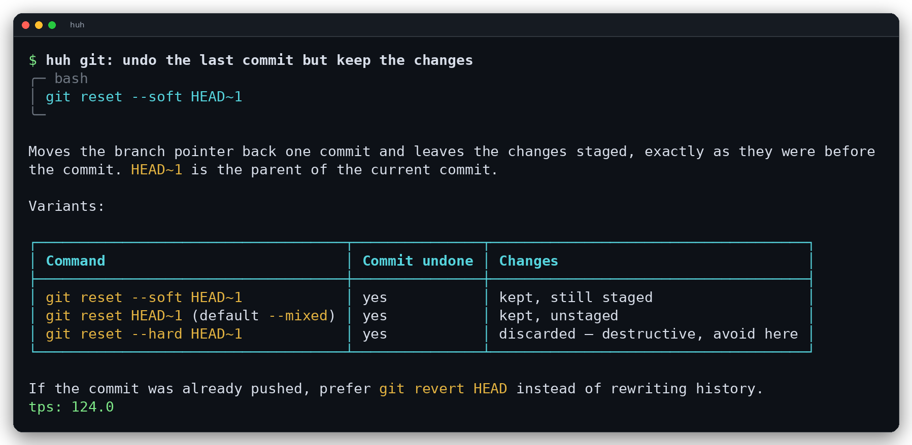
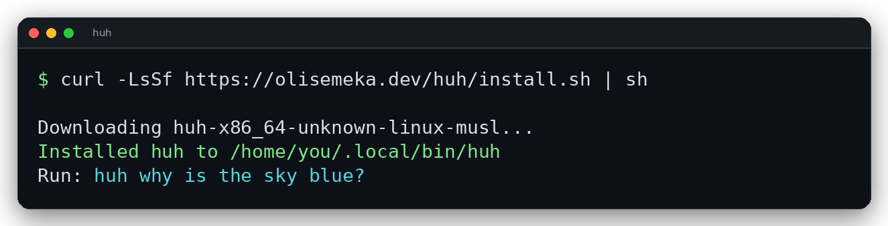
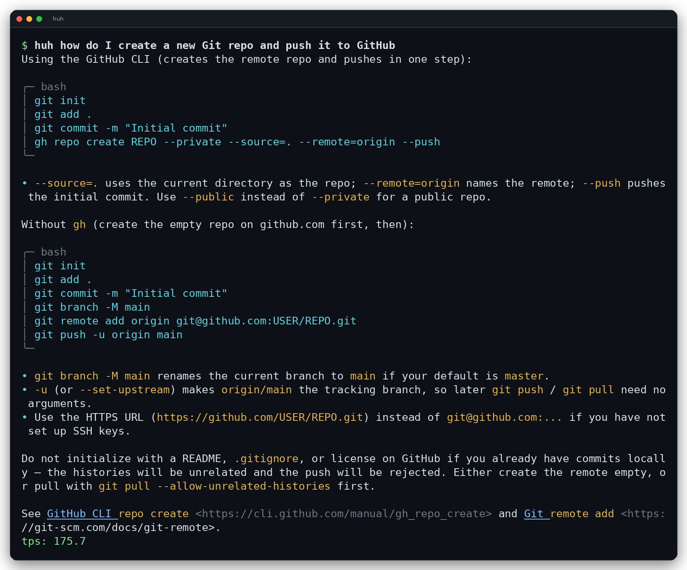
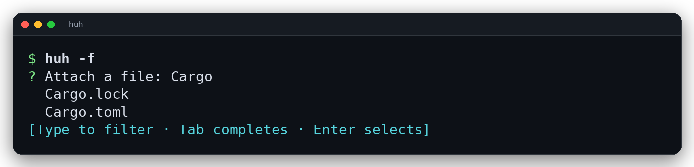
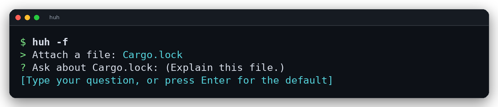
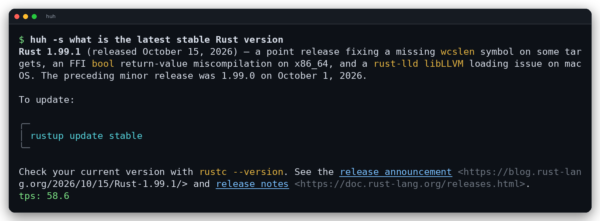

<p align="center">
  
</p>

`huh` is a small assistant for your terminal. Ask a question in plain English and get a short, readable answer without opening a browser or leaving the shell.



## Why use it

- **Answers appear as they are written.** You see the first line almost immediately instead of waiting for a blank screen.
- **It is made for a terminal.** Headings, lists, code blocks, links, and tables are formatted for your window. Piped output stays as plain Markdown, and `NO_COLOR=1` turns off colors.
- **It can look things up.** Web search is used automatically when a question needs current information.
- **It can read your files.** Attach one or more files, or pick one interactively.
- **It remembers the last conversation.** Use `-c` to ask a follow-up.
- **It runs where you do.** Linux, macOS, and Windows are supported.

## Requirements

- An [OpenRouter API key](https://openrouter.ai/keys).
- A Rust toolchain (from [rustup.rs](https://rustup.rs)) only if you build from source.

## Install

The quickest way:

```sh
curl -LsSf https://olisemeka.dev/huh/install.sh | sh
```

The installer downloads the right build for your computer, checks its SHA-256 checksum, and installs `huh` to `~/.local/bin/huh`. It supports Linux (x86_64, aarch64, armv7, and i686) and macOS (Intel and Apple silicon). Under Git Bash, MSYS2, or Cygwin it hands off to the PowerShell installer.

Set `HUH_INSTALL_DIR` to install somewhere else, or `HUH_VERSION=v0.1.0` to pin a release.



### Windows

```powershell
irm https://olisemeka.dev/huh/install.ps1 | iex
```

The PowerShell installer picks the native x64, ARM64, or x86 build, installs to `%USERPROFILE%\.local\bin`, and adds that directory to your user PATH. Open a new terminal afterward.

### From source

You need a Rust toolchain. Install it from [rustup.rs](https://rustup.rs) if you do not have one.

```sh
cargo install --path . --locked
```

Or build a release binary and copy it somewhere on your PATH:

```sh
cargo build --release --locked
install -m 0755 target/release/huh ~/.local/bin/huh
```

## Set up your API key

`huh` uses [OpenRouter](https://openrouter.ai) for answers, so you need an OpenRouter API key. Create one at [openrouter.ai/keys](https://openrouter.ai/keys), then save it once:

```sh
huh --login
```

You can also provide the key through the environment. This overrides the saved key:

```sh
export OPENROUTER_API_KEY="sk-..."
```

The config lives at `${XDG_CONFIG_HOME:-$HOME/.config}/huh/config.json`. It can also hold a default model and search mode:

```json
{
  "api_key": "sk-...",
  "model": "openai/gpt-oss-120b:nitro",
  "search": "auto"
}
```

`search` accepts `auto`, `on`, or `off`. The `-m`, `-s`, and `-ns` flags override these values for one request. `HUH_MODEL` overrides the model for the current shell.

## Ask a question

```sh
huh why is the sky blue
huh how do I create a new Git repo and push it to GitHub
echo "explain closures in Rust" | huh
huh -- what does -v mean
```

Options go before the question. The remaining words are joined into one question, so quotes are optional for ordinary words. Use quotes when the question contains shell characters such as `?`, `*`, `|`, `$`, or `(`. Use `--` when the question starts with `-`.



A few more examples:

```sh
huh git: undo the last commit but keep the changes
huh how do I rebase onto main and resolve conflicts
huh what is the rsync command to copy a folder but skip node_modules
huh compare Postgres and SQLite for a small local app
```

## Attach a file

Point `huh` at a file with `-f`. Repeat the flag to attach more than one file:

```sh
huh -f src/main.rs
huh -f build.log why did this build fail
huh -f Cargo.toml -f src/main.rs review these files for problems
```

If you leave out the path, `huh` opens an interactive picker. Type to filter, press Tab to complete, and press Enter to open a directory or select a file.

```sh
huh -f
```



After you pick a file, `huh` asks what you want to know and suggests "Explain this file." Press Enter to accept it.



Only files you name explicitly are read. Each file is limited to 256 KiB and all attached files together are limited to 512 KiB. Piped input is read up to 16 MiB and cut down to the last 256 KiB, so long logs keep their final errors. Attached file contents are saved with the conversation, so `-c` can refer back to them.

## Search the web

Web search is on by default. `huh` decides when a question needs current information and searches only then. Force a search with `-s`, or turn it off for one request with `-ns`:

```sh
huh -s what changed in the latest Rust release
huh -ns difference between TCP and UDP
```

Search results are cited as Markdown links. OpenRouter charges a small per-search fee on top of the model usage.



## Continue a conversation

Plain `huh` starts a fresh conversation and replaces the saved session. Use `-c` to follow up on the previous one:

```sh
huh explain Rust ownership
huh -c now show a small example
```

The session lives at `${XDG_STATE_HOME:-$HOME/.local/state}/huh/session.json`. History keeps up to 10 question-and-answer pairs (20 messages) and about 80,000 characters. The first pair is kept as the starting context; the oldest middle pairs are dropped first. If the first and latest pairs still do not fit, the first pair is dropped too, and the latest pair is always kept.

## Choose a model

The default model is `openai/gpt-oss-120b:nitro`. Use `-m` to pick a different model for one request:

```sh
huh -f src/main.rs -m openai/gpt-5-mini review this file and list the risks
```

`huh` only sees your question and the files you attach with `-f`. It cannot browse your repository or run commands.

## Update

If you installed with the curl script, run it again to get the latest release:

```sh
curl -LsSf https://olisemeka.dev/huh/install.sh | sh
```

If you installed from source, `huh -u` rebuilds and reinstalls the running binary. It uses the source tree the binary was built from and does not run `git pull`, so do that first. The build happens before the install, so a failed build leaves the current binary untouched.

## Options

| Option / command | What it does |
| --- | --- |
| `-c`, `--continue` | Continue the previous conversation |
| `-f`, `--file [path]` | Attach a file; omit the path to pick one |
| `-s`, `--search` | Force a web search |
| `-ns`, `--no-search` | Disable web search for this request |
| `-m`, `--model <name>` | Use a different model for this request |
| `-u`, `--update` | Rebuild and install from source |
| `--login` | Save your OpenRouter API key |
| `--logout` | Remove the saved API key |
| `--config` | Show the current configuration |
| `-V`, `--version` | Show the version |
| `-h`, `--help` | Show help |

## Small on purpose

`huh` starts instantly, uses very little memory, and keeps its state in two plain files. There is no daemon, no database, and no browser involved. It is meant to feel like another small command in your shell, not a separate app.

## Development

```sh
cargo build
cargo test
cargo fmt --check
cargo clippy --all-targets -- -D warnings
```

## Uninstall

```sh
rm "${BIN_DIR:-$HOME/.local/bin}/huh"
rm -r "${XDG_CONFIG_HOME:-$HOME/.config}/huh"
rm -r "${XDG_STATE_HOME:-$HOME/.local/state}/huh"
```

## Links

- Source: [github.com/OliseNS/huh](https://github.com/OliseNS/huh)
- Installer: [olisemeka.dev/huh/install.sh](https://olisemeka.dev/huh/install.sh)
- OpenRouter: [openrouter.ai](https://openrouter.ai)
